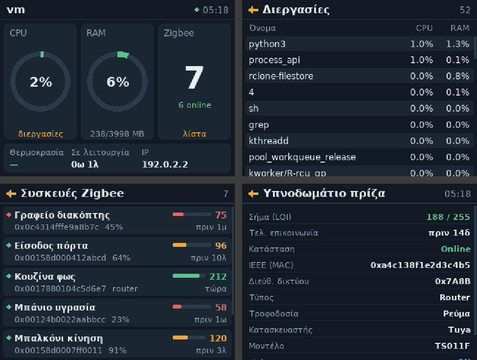

# Zigbee Panel

Οθόνη πληροφοριών για Raspberry Pi Zero W με οθόνη αφής 3.2" SPI (320×240, [LCDwiki 3.2inch RPi Display](https://lcdwiki.com/3.2inch_RPi_Display) MPI3201, ILI9341 / XPT2046).
Δείχνει CPU, RAM, θερμοκρασία, διεργασίες και τις συσκευές Zigbee.
Το Pi κάνει γέφυρα για τον USB Zigbee coordinator (ser2net) προς το Home Assistant.

```
[USB stick] ── Pi Zero W (ser2net :6638) ── WiFi ──> Home Assistant
                     ▲                                 ├─ Zigbee2MQTT add-on
                     └──────── MQTT (συσκευές) ─────── └─ Mosquitto add-on
```



## Προετοιμασία κάρτας SD

Με το [Raspberry Pi Imager](https://www.raspberrypi.com/software/) γράψε **Raspberry Pi OS Lite (32-bit)**
(χωρίς desktop: ο Zero W δεν το σηκώνει). Στις ρυθμίσεις του Imager (OS customisation) βάλε
hostname, χρήστη/κωδικό, WiFi και ενεργοποίησε το **SSH**.

**Μην τρέξεις το `LCD32-show` της LCDwiki.** Ο driver της οθόνης μπαίνει από το `install.sh`
(δικό μας overlay στο `drivers/`, με τα ίδια pins, χωρίς αλλαγές σε άλλα αρχεία του συστήματος).

## Εγκατάσταση (μία φορά)

```bash
cd ~
git clone https://github.com/<ΤΟ-USERNAME-ΣΟΥ>/zigbee-panel.git
cd zigbee-panel
./install.sh
```

Το `install.sh` προσθέτει τον driver της οθόνης στο `config.txt`. Μετά το reboot:

```bash
./calibrate.sh     # πατάς τρεις σταυρούς για να ευθυγραμμιστεί η αφή
```

Οι ρυθμίσεις (MQTT, οθόνη, αφή) είναι στο `panel.env`, που δεν ανεβαίνει στο GitHub.

## Coordinator

Όταν συνδέσεις το USB stick:

```bash
./coordinator.sh
```

Στο τέλος σου δείχνει τι να βάλεις στο add-on Zigbee2MQTT του Home Assistant
(`serial: port: tcp://<IP-του-Pi>:6638`). Στην αρχική οθόνη, η ένδειξη Coordinator δείχνει:
«Χωρίς stick», «ser2net off», «Αναμονή HA» ή «Σε HA».

## Ενημέρωση

```bash
~/zigbee-panel/update.sh
```

## Αν δεν ανάβει η οθόνη

```bash
ls /dev/fb*                 # πρέπει να υπάρχει /dev/fb1 (ή fb0 χωρίς HDMI)
dmesg | grep -iE "fbtft|ili|ads7846"
```

Αν η οθόνη είναι fb0, βάλε `PANEL_FB=/dev/fb0` στο `panel.env`. Αν η εικόνα είναι
ανάποδα: `./display.sh 90`, `sudo reboot` και μετά `./calibrate.sh`.

Αν κάποιο σημείο της οθόνης δεν πιάνει την αφή, μπορείς να ανεβάσεις ακόμα το όριο πίεσης
αλλάζοντας τη γραμμή στο config.txt σε `dtoverlay=zigbee-lcd32,rotate=270,pmax=8000`.

## Πλοήγηση

Πάτημα στην κάρτα CPU → διεργασίες, στην κάρτα Zigbee → συσκευές, σε συσκευή → λεπτομέρειες.
**Πίσω:** πάτημα οπουδήποτε στο αριστερό μισό της κεφαλίδας, ή σύρσιμο του δαχτύλου προς τα δεξιά.

## Κονσόλα στην οθόνη

Τα μηνύματα εκκίνησης και τερματισμού εμφανίζονται στην οθόνη αφής (`fbcon=map:10` στο
`cmdline.txt`). Όσο τρέχει η εφαρμογή, η κονσόλα αποσυνδέεται (`console.sh`) για να μη
γράφει από πάνω της. Τα πρώτα 2-3 δευτερόλεπτα της εκκίνησης η οθόνη μένει λευκή:
είναι πριν φορτώσει ο driver και δεν αλλάζει.

## Χρήσιμες εντολές

| Τι | Εντολή |
|---|---|
| Δοκιμή χωρίς Zigbee | `PANEL_DEMO=1 python3 zigbee_panel.py` |
| Δοκιμή στον υπολογιστή (παράθυρο) | `PANEL_DEMO=1 PANEL_OUTPUT=sdl PANEL_FULLSCREEN=0 python3 zigbee_panel.py` |
| Βαθμονόμηση αφής | `./calibrate.sh` |
| Δοκιμή αφής (δείχνει πού πέφτει το πάτημα) | `./touchtest.sh` |
| Logs | `journalctl -u zigbee-panel -f` |
| Επανεκκίνηση | `sudo systemctl restart zigbee-panel` |

## Ρυθμίσεις Zigbee2MQTT (στο Home Assistant)

Για σωστή «τελευταία επικοινωνία» και ένδειξη online/offline, στο `configuration.yaml` του Zigbee2MQTT:

```yaml
advanced:
  last_seen: ISO_8601
availability: true
```
